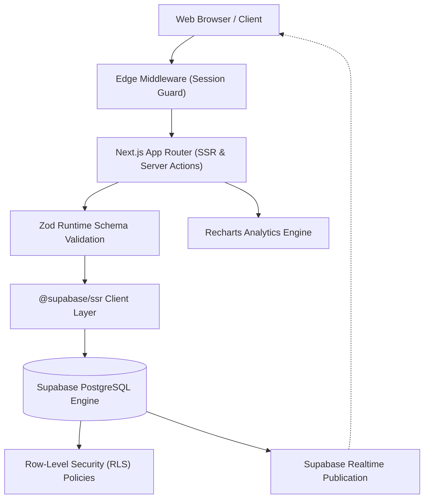

# TaskFlow — Real-Time Collaborative Task Manager

[](https://taskflow-83zo.onrender.com)
[](https://nextjs.org/)
[](https://www.typescriptlang.org/)
[](https://tailwindcss.com/)
[](https://supabase.com/)
[](LICENSE)

**TaskFlow** is a full-stack, real-time collaborative task management platform engineered with Next.js App Router, TypeScript, Tailwind CSS, and Supabase (PostgreSQL with Row-Level Security). Deployed to production on Render.

---

## 🚀 Live Production Links

* **Live Public Application:** [https://taskflow-83zo.onrender.com](https://taskflow-83zo.onrender.com)
* **GitHub Repository:** [https://github.com/67sdnew-hash/taskflow](https://github.com/67sdnew-hash/taskflow)

### Instant Demo Credentials
| Role | Email | Password |
| :--- | :--- | :--- |
| **Demo Admin** | `demo@taskflow.live` | `TaskFlow2026!` |

---

## ⚡ Core Features (MVP)

1. **Enterprise Authentication & Session Management:**
   * Secure email/password authentication and Google OAuth support.
   * Session refresh handled via Next.js Edge Middleware and `@supabase/ssr` with HttpOnly cookies.
   * Auto-provisioned user profile records tied to `auth.users` via PostgreSQL triggers.

2. **Full-Featured Task Management:**
   * Create, read, update, and delete tasks with instant optimistic updates and Server Action mutations.
   * Filter tasks by **Status** (`TODO`, `IN_PROGRESS`, `IN_REVIEW`, `COMPLETED`), **Priority** (`LOW`, `MEDIUM`, `HIGH`, `URGENT`), and real-time search queries.
   * Due date scheduling with formatted calendar metadata.

3. **Row-Level Security (RLS) Isolation:**
   * Multi-tenant data segregation enforced directly within the PostgreSQL engine.
   * Users can only view, insert, edit, and delete their own scoped records.

4. **Real-Time Analytics Dashboard:**
   * Interactive data visualization using Recharts.
   * Metrics include Total Task count, Completion Velocity, Task Status distribution (Pie Chart), and Priority Level distribution (Bar Chart).

---

## 🏛 Architecture & Tech Stack



| Component | Technology | Purpose |
| :--- | :--- | :--- |
| **Frontend Framework** | Next.js (App Router) | Server-Side Rendering (SSR), Server Components & Actions |
| **Language** | TypeScript | Strict compile-time type safety |
| **Styling** | Tailwind CSS + Lucide Icons | Responsive modern UI design system |
| **Form Validation** | Zod | Runtime schema validation on client and server |
| **Database & Auth** | Supabase (PostgreSQL) | Managed database, authentication & Row-Level Security |
| **Analytics Engine** | Recharts | SVG interactive chart visualizers |
| **Hosting & CI/CD** | Render + GitHub | Continuous zero-downtime deployment |

---

## 📁 Project Structure

```text
taskflow/
├── .env.example                         # Environment configuration schema
├── render.yaml                          # Render infrastructure-as-code blueprint
├── next.config.ts                       # Next.js security headers & image domains
├── package.json                         # Dependencies & run scripts
├── tsconfig.json                        # Strict TypeScript configuration
├── supabase/
│   └── migrations/
│       └── 20261113000000_init_schema.sql # Complete DDL, RLS, triggers & enums
├── src/
│   ├── app/
│   │   ├── (auth)/                      # Guest-only authentication routes
│   │   │   ├── login/page.tsx
│   │   │   ├── signup/page.tsx
│   │   │   └── layout.tsx
│   │   ├── (dashboard)/                 # Protected authenticated shell
│   │   │   ├── dashboard/page.tsx       # Analytics overview
│   │   │   ├── tasks/page.tsx           # Task board & management
│   │   │   └── layout.tsx
│   │   ├── api/
│   │   │   ├── auth/callback/route.ts   # OAuth & confirmation handler
│   │   │   └── tasks/                   # REST API fallback endpoints
│   │   ├── globals.css
│   │   ├── layout.tsx                   # Root HTML shell
│   │   └── page.tsx                     # Landing page
│   ├── components/
│   │   ├── analytics/                   # Metric cards & Recharts components
│   │   ├── auth/                        # LoginForm, SignupForm, OAuthButtons
│   │   ├── layout/                      # Header, Sidebar, UserNav
│   │   ├── tasks/                       # TaskCard, TaskDialog, TaskFilters
│   │   └── ui/                          # Button, Input, Badge primitives
│   ├── lib/
│   │   ├── actions/                     # Server Actions (tasks.ts, auth.ts)
│   │   ├── supabase/                    # SSR client, server, and middleware
│   │   ├── validations/                 # Zod schemas for tasks and auth
│   │   └── utils.ts                     # Class merges & date formatters
│   ├── middleware.ts                    # Edge session protection
│   └── types/
│       └── database.types.ts            # Generated PostgreSQL TypeScript types
```

---

## 🛠 Local Development Setup

### Prerequisites
* **Node.js:** `v20.x` or `v24.x`
* **npm:** `v10.x` or higher
* **Git**

### Installation

1. **Clone the repository:**
   ```bash
   git clone https://github.com/67sdnew-hash/taskflow.git
   cd taskflow
   ```

2. **Install dependencies:**
   ```bash
   npm install
   ```

3. **Configure environment variables:**
   ```bash
   cp .env.example .env.local
   ```
   Populate `.env.local` with your Supabase credentials:
   ```env
   NEXT_PUBLIC_APP_URL="http://localhost:3000"
   NEXT_PUBLIC_SUPABASE_URL="https://your-project.supabase.co"
   NEXT_PUBLIC_SUPABASE_ANON_KEY="your-anon-publishable-key"
   SUPABASE_SERVICE_ROLE_KEY="your-service-role-key"
   ```

4. **Initialize Database Schema:**
   Copy the contents of `supabase/migrations/20261113000000_init_schema.sql` and run them in your Supabase project's SQL Editor.

5. **Start Development Server:**
   ```bash
   npm run dev
   ```
   Open [http://localhost:3000](http://localhost:3000) in your browser.

---

## 🚢 Production Deployment (Render)

This repository includes a `render.yaml` specification for immediate deployment:

1. Link your GitHub repository to [Render](https://dashboard.render.com).
2. Choose **Web Service** with the following settings:
   * **Build Command:** `npm install && npm run build`
   * **Start Command:** `npm run start`
   * **Runtime:** `Node`
3. Add the following environment variables:
   * `NODE_VERSION` = `20.18.0`
   * `NEXT_PUBLIC_SUPABASE_URL` = *(Your Supabase URL)*
   * `NEXT_PUBLIC_SUPABASE_ANON_KEY` = *(Your Supabase Anon Key)*
   * `SUPABASE_SERVICE_ROLE_KEY` = *(Your Supabase Service Role Key)*
   * `NEXT_PUBLIC_APP_URL` = `https://<your-render-domain>.onrender.com`
4. Register your live Render domain in Supabase Auth -> **URL Configuration**.

---

## 📄 License
This project is licensed under the MIT License — see the [LICENSE](LICENSE) file for details.
